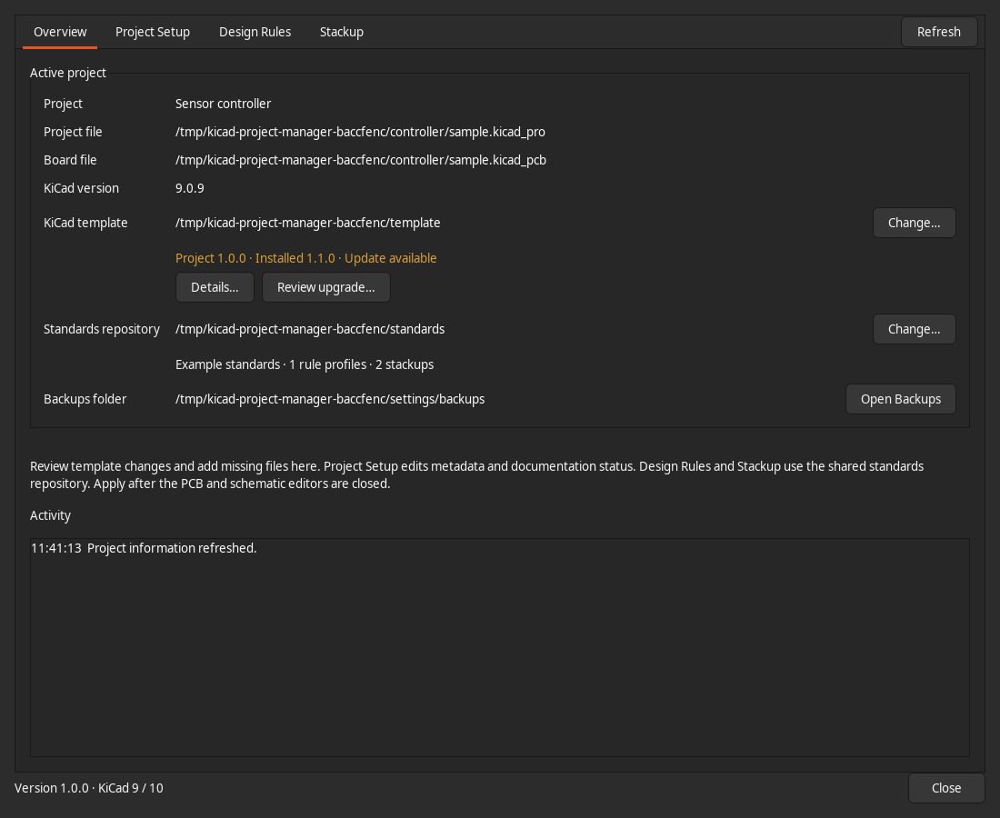
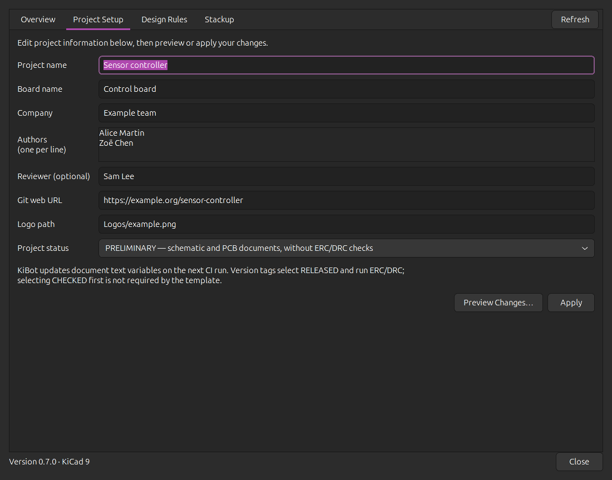
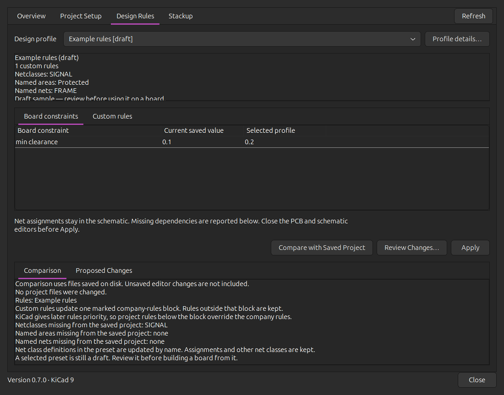
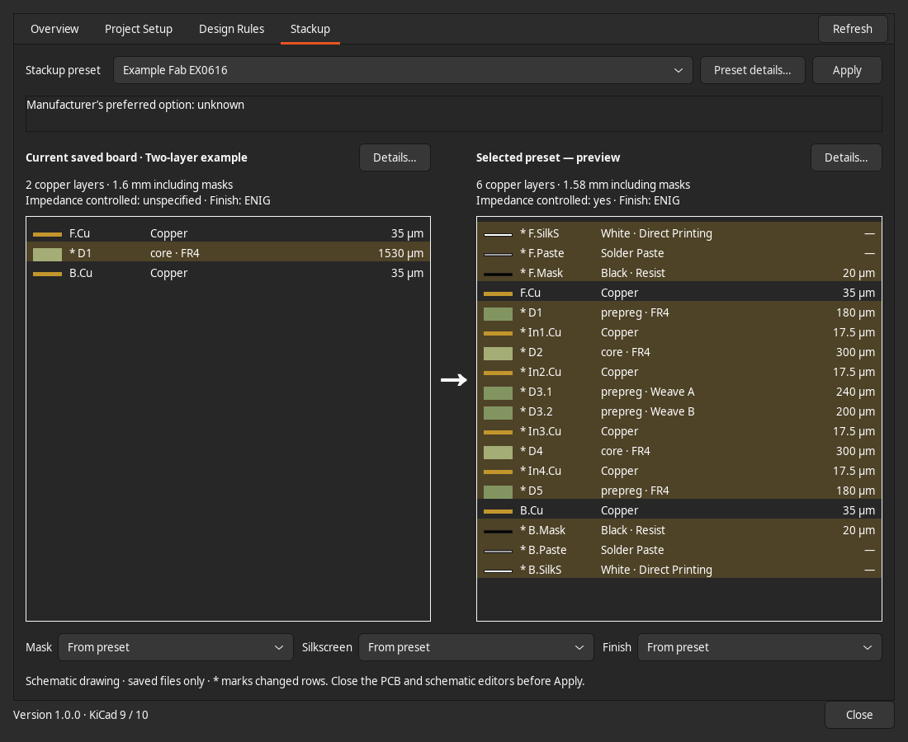

# KiCad Project Manager

A native **KiCad 9 / 10** plugin for KiBot project setup, template updates, design
rules and PCB stackups. Use your own compatible templates and standards folders.

## KiCad 10 port trial

For the five-repository development setup and one-command symlink installation,
see [Mac trial setup](docs/port-mac.md). This branch has not been released to PCM.

## Install

1. Enable **Preferences → Plugins → Enable KiCad API**. On Debian/Ubuntu, install
   `python3-pip python3-venv python3-wxgtk4.0` and select the system Python.
   macOS/Windows use KiCad’s bundled Python.
2. In **Plugin and Content Manager → Manage…**, add:
   ```text
   https://coprod-llc.github.io/kicad_project_manager/repository.json
   ```
3. Install **KiCad Project Manager**, apply pending changes and restart PCB Editor.
   Open the plugin from its toolbar button or **Tools → External Plugins**.

Alternatively, install the packaged ZIP from [Releases](https://github.com/coprod-LLC/kicad_project_manager/releases).
Packages are marked **Testing**. When upgrading from the previous package identity,
uninstall that copy first; the generic ID is now `org.kicadprojectmanager.plugin`.

## Use

| Page | What to do |
| --- | --- |
| **Overview** | Choose a local versioned template and standards folder. Review template differences and find backups. |
| **Project Setup** | Edit metadata, authors, reviewer and workflow status; preview or apply. Requires compatible KiBot configuration. |
| **Design Rules** | Select a rule profile, compare constraints and custom rules, then apply. |
| **Stackup** | Compare saved and proposed constructions, adjust appearance, apply a preset or save an unmatched saved construction as a new preset. |

In **Review upgrade…**, Shift-click a range or Ctrl-click individual files, then
choose an action for the selection. **Apply**, beside **Preview Apply…**, saves
directly and keeps the review window open. Undecided files stay pending.

Save the project and close PCB/schematic editors before **applying standards**;
reopen afterward. Changes use local backups and reject intervening edits. Template
updates preserve project metadata and leave board/schematic contents unchanged.
Source folders are local; update them separately, then **Refresh**.

| Overview | Project Setup |
| --- | --- |
| [](docs/screenshots/overview.png) | [](docs/screenshots/project-setup.png) |
| **Design Rules** | **Stackup** |
| [](docs/screenshots/design-rules.png) | [](docs/screenshots/stackup.png) |

[Usage, compatibility and recovery](docs/usage.md) ·
[Standards format](docs/standards-format.md) ·
[Development and releases](docs/development.md) · [MIT license](LICENSE)

Uses KiCad’s IPC plugin conventions and the KiBot workflow patterns of
[KDT_Hierarchical_KiBot](https://github.com/nguyen-v/KDT_Hierarchical_KiBot).
