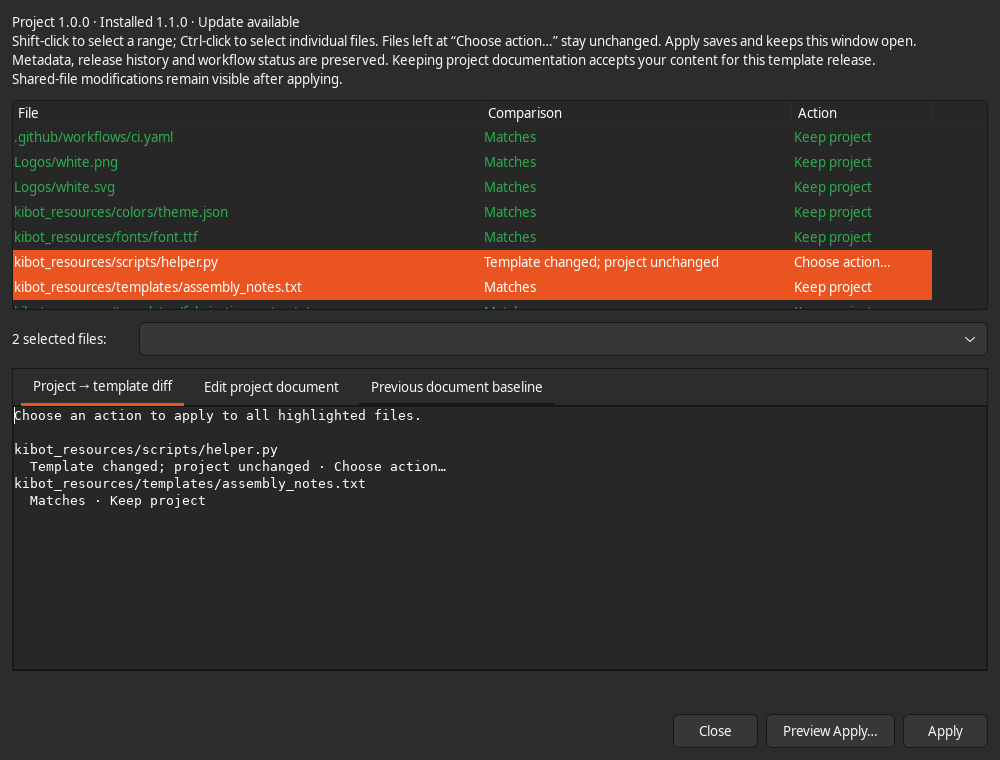

# Usage and recovery

## Compatibility and sources

KiCad 9 and 10 are supported. Project Setup and template review expect the KiBot layout
described below; design rules and stackup features also work with saved KiCad 9
projects without KiBot configuration. No particular organization’s template or
catalog is required. Templates and standards are separate local folders or Git
checkouts; the plugin does not fetch, commit, push or run CI.

On Overview, select a source with **Choose template…** or **Standards repository →
Change…**. Source paths are remembered on this computer. **Refresh** reloads
project files and the catalog. An installed template is the comparison source;
its version does not establish that it is the latest remote release.

## Template review

A versioned template contains `kibot_resources/project_manager/template.json`.
New KiCad projects may carry a copy of that manifest. Older projects keep an
unknown history until reviewed. Sources with missing, added or modified managed
files must be restored or published as a new version before use; **Details…**
lists the affected paths. Downgrades and switching template identities are refused.

The managed inventory covers KiBot YAML, `.github/workflows/ci.yaml`,
`kibot_launch.sh`, drawing sheets in `Templates/`, and supported resources in
`kibot_resources/{fonts,colors,scripts,templates}`. Board, schematic, project
settings, custom rules and extra project files are outside template upgrades.

**Review adoption…** / **Review upgrade…** shows matches in green, differences in
amber and missing files in red, with text labels. Matching files start at **Keep
project**; differences start at **Choose action…**. Shift-click selects a range;
Ctrl-click adds individual files. The action list offers choices valid for the
whole selection. **Keep project** accepts existing content, **Use template**
replaces it, and **Choose action…** leaves the file pending.

Select one project document to edit it. The four supported document sources are
`fabrication_notes.txt`, `assembly_notes.txt`, `impedance_table.txt` and
`readme.txt` under `kibot_resources/templates/`. Prior document baselines and
non-overlapping three-way merge proposals help reconcile incoming guidance.
Keeping a document accepts that release’s baseline; kept shared-file differences
continue to appear as local modifications.

**Apply** saves directly and keeps review open with refreshed results. Repeat it
for another batch. **Preview Apply…** shows the writes; accepting that preview
applies and closes review. Closing review retains anything already applied.
Undecided files keep their contents and previous baselines. The recorded template
version identifies the reviewed source; outstanding differences still determine
whether the project matches. Commit the records in
`kibot_resources/project_manager/` with the project.

## Project Setup

Setup edits `definitions` metadata in `kibot_yaml/kibot_main.yaml` and the workflow’s
`env.kibot_variant` and **KiCad version for CI** (`env.kicad_version`). Authors share the existing `DESIGNER` field. An optional
`REVIEWER` is added only when entered. Missing workflows are added through template
review; workflow status stays unavailable until the file exists.

After **Apply**, a green message confirms that changes were saved and remains
visible after refresh. Save failures show a red message and an error dialog;
your edits remain available to correct or retry. Editing a field clears the
previous outcome. Applying unchanged values shows “No changes to save.”

**DRAFT**, **PRELIMINARY** and **CHECKED** select the workflow’s documentation/check
mode. Version tags control **RELEASED**. KiBot propagates metadata into text
variables and reports on the next run. Saving setup does not run checks or
establish that an electrical design has been verified.

In a KiCad 10 editor, an existing KiCad 9 CI target is suggested as **KiCad 10**.
The message identifies the mismatch; **Apply** saves the selected target into the
workflow. Opening the plugin alone changes no files. A newer CI target is never
automatically downgraded. Template updates preserve this project choice; use
Project Setup to change it. Files saved with KiCad 10 need a KiCad 10 CI target.

Existing values, scalar quoting, comments, newline conventions and branch policies
are preserved where supported. Templates substitute metadata into multiple YAML
contexts, so apostrophes, `colon: space`, comment sequences, macro expressions and
ambiguous YAML scalars are rejected with an explanation. Multiline scalars and
anchors on managed fields are unsupported. Unexpected layouts are rejected.

Template comparison ignores allowed metadata values, workflow status, CI KiCad version and standard
numbered changelog title/body extraction entries; other shared configuration stays
checked. When uncommenting release entries, align `- variable` with the other
list entries and indent `command` two spaces further.

## Rules and stackups

Choose a folder containing `catalog.json`; see [the format](standards-format.md).
Select a preset and inspect its details. Rule comparisons show constraints,
custom rules and missing named netclasses, nets or areas. Applications preserve
project exceptions, schematic net assignments and unrelated settings.

Stackup shows the saved board and selected preset side by side, including
dielectric sublayers and surface properties. Mask, silkscreen and finish overrides
are explicit. A copper layer still used by the board cannot be removed. Matching
uses physical properties rather than preset names. Impedance guides describe
routing geometry; they do not assign nets or change widths.

Save and close both PCB and schematic editors before applying standards, then
reopen. `kpm-standards.json` records source hashes, presets and appearance choices.
Repeated application of unchanged settings makes no further file changes.

**Save as preset…** appears for a saved construction without a catalog match.
Save the board first; editors may remain open for capture. Enter metadata and
optional impedance guides, review duplicate/similar constructions and save one
new JSON file. Saving refuses an existing destination or changed source/catalog.
It refreshes the catalog and selects the new preset without changing the board.

## Backups and troubleshooting

Overview’s **Open Backups** and activity log show backup locations. User settings
and backups are outside the project:

| Platform | Directory |
| --- | --- |
| Linux | `${XDG_DATA_HOME:-~/.local/share}/kicad_project_manager/` |
| macOS | `~/Library/Application Support/kicad_project_manager/` |
| Windows | `%LOCALAPPDATA%\kicad_project_manager\` |

Each backup includes original files and a `manifest.json`. To restore, close the
plugin and editors, review any later changes, then copy originals to their
project-relative paths. An entry with `existed: false` identifies a newly created
file: remove that file when undoing the apply. A failed multi-file save rolls back
its writes when no external edit has intervened.

- **No toolbar button:** enable KiCad API, check Python/wxPython, recreate the
  plugin environment in Preferences → Plugins and restart PCB Editor.
- **Project unavailable:** save/open the board, close modal editor dialogs and Refresh.
- **Changed during review:** Refresh and review again; external edits are preserved.
- **Configuration/workflow missing:** select a compatible versioned template and
  add it through template review. The source picker starts in KiCad’s user template
  folder; `KICAD_USER_TEMPLATE_DIR` overrides that location.
- **Previously installed PCM copy:** uninstall it before installing the generic
  `org.kicadprojectmanager.plugin` package. Existing projects and user backups stay in
  their current locations.
